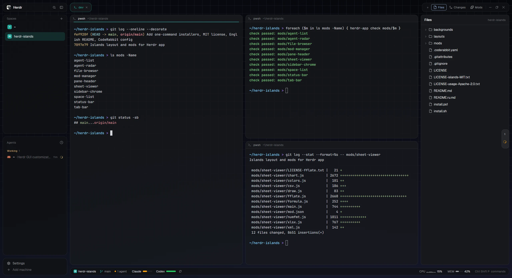
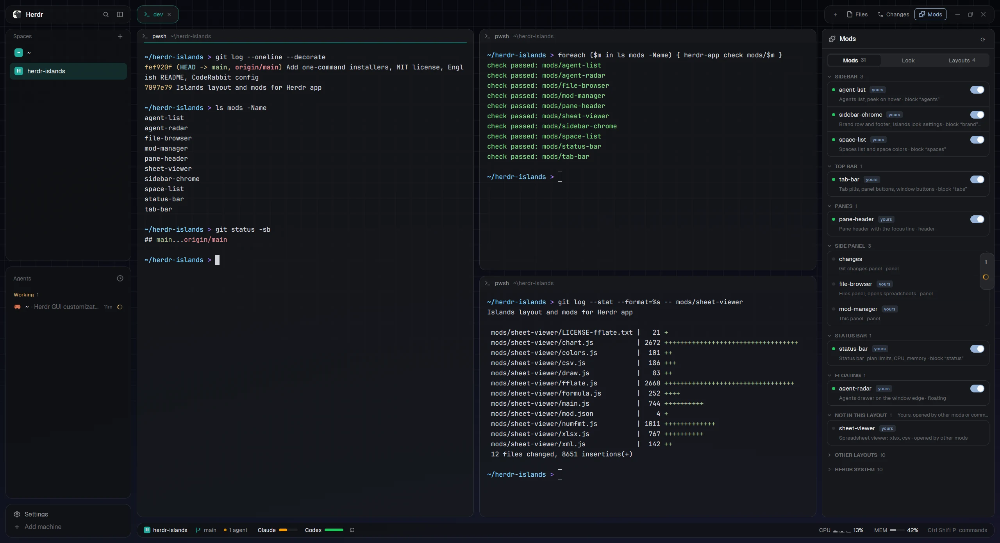
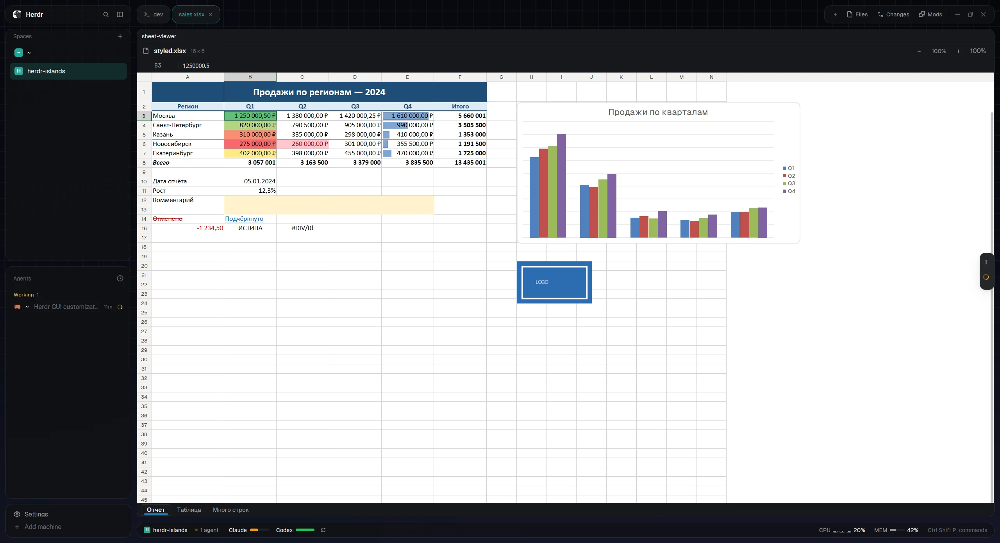

# Herdr Islands

**English** · [Русский](README.ru.md)

A layout and a set of mods for [Herdr app](https://herdr.dev): every panel is its own rounded card
floating over a grid that fades into a gradient. It also adds a status bar with your AI plan limits, a
Mods menu, agent previews and a spreadsheet viewer. Built for Windows and macOS; tested live on
Windows 11, while the macOS code paths (`iostat`, `vm_stat`, Keychain, `unzip`) haven't run on a real Mac yet.



## Install

One command. Herdr can stay open, and running it again updates everything without touching your settings.

**Windows** (PowerShell):

```powershell
irm https://raw.githubusercontent.com/Yofukashiya/herdr-islands/main/install.ps1 | iex
```

**macOS** (Terminal):

```sh
curl -fsSL https://raw.githubusercontent.com/Yofukashiya/herdr-islands/main/install.sh | sh
```

You need Herdr app 0.1.13 or newer. On a Mac, open Herdr once from Applications before running the
command: on first launch it creates the `herdr-app` command the script uses.

The script:
1. downloads this repository;
2. copies the mods, the layout and the backdrop into `~/.config/herdr-app`;
3. checks every mod with `herdr-app check`;
4. starts Herdr if it isn't running and switches it to the Islands layout.

New mod folders go in with a single rename, so an open Herdr never sees a half-copied mod (it would
dock it as an extra panel). Nothing else in your Herdr folder is touched: themes, keys and other layouts
stay as they are.

<details>
<summary>Install from a clone, or by hand</summary>

From a clone: `powershell -ExecutionPolicy Bypass -File install.ps1` on Windows, `sh install.sh` on macOS.

By hand, with Herdr closed: copy `layouts`, `mods` and `backgrounds` into `~/.config/herdr-app`
(on Windows `C:\Users\<you>\.config\herdr-app`). Then open Herdr and run
`herdr-app do layout.switch --name islands`, or cycle layouts with Ctrl+Shift+L.
Copy real files, not symlinks: Herdr doesn't open images through symlinks.
</details>

On a Mac, the first time the status bar asks for your Claude limits, macOS asks whether `security` may
read "Claude Code-credentials" from the Keychain (that's where Claude Code keeps its login). Click
**Always Allow**. If you deny it, Claude just doesn't show up in the bar.

### Just some mods

Every mod also works on its own, in your own layout. Name the ones you want:

```powershell
& ([scriptblock]::Create((irm https://raw.githubusercontent.com/Yofukashiya/herdr-islands/main/install.ps1))) status-bar sheet-viewer
```

```sh
curl -fsSL https://raw.githubusercontent.com/Yofukashiya/herdr-islands/main/install.sh | sh -s -- status-bar sheet-viewer
```

This installs only those mods, with no layout and no layout switch, and prints where each one goes.
The table below says the same, and each mod's README has the details.

### Updates

Islands tells you when a new release is out. Once a day it asks GitHub. When there's a newer version,
Herdr shows a notice (click it to open Mods), and the Mods panel offers **What's new** and **Update**.
**Update** installs that release in the background and Herdr reloads the mods: your settings stay, and
your layout isn't switched. The version you have and a **Check for updates** button sit at the top of
Mods.

To get releases without being asked, turn on **Install updates automatically** in Mods → Look, or set
`"auto_update": true` in `mods/sidebar-chrome/settings.json`. It's off by default, since it runs the
new release's installer by itself.

By hand, or if you installed only some mods (the notices need `sidebar-chrome` or `mod-manager`), run
the install command again. With `--update` it updates only what you have, without switching layouts:

```powershell
& ([scriptblock]::Create((irm https://raw.githubusercontent.com/Yofukashiya/herdr-islands/main/install.ps1))) --update
```

```sh
curl -fsSL https://raw.githubusercontent.com/Yofukashiya/herdr-islands/main/install.sh | sh -s -- --update
```

### Update and uninstall

To update, run the same command again. Your Look settings (`mods/sidebar-chrome/settings.json`) are
kept. The `islands` layout file itself is replaced, so blocks you switched off in Mods come back
([#4](https://github.com/Yofukashiya/herdr-islands/issues/4)).

To uninstall, switch to another layout (Ctrl+Shift+L), then delete `layouts/islands.json`,
`layouts/islands.svg`, `backgrounds/islands-grid.png` and these folders in `~/.config/herdr-app/mods`:
`sidebar-chrome`, `space-list`, `agent-list`, `tab-bar`, `pane-header`, `file-browser`, `git-changes`,
`mod-manager`, `status-bar`, `agent-radar`, `sheet-viewer`.

## What's inside

| Mod | What it does | On its own |
|---|---|---|
| [`sidebar-chrome`](mods/sidebar-chrome/README.md) | Top and bottom cards of the sidebar; applies the look settings | replaces `workspace-chrome` |
| [`space-list`](mods/space-list/README.md) | Spaces and their colors | replaces `spaces` |
| [`agent-list`](mods/agent-list/README.md) | Agents, with a preview of an agent's screen on hover | replaces `agents` |
| [`tab-bar`](mods/tab-bar/README.md) | Pill tabs, the Files / Changes / Mods buttons, window buttons | replaces `tabs` |
| [`pane-header`](mods/pane-header/README.md) | Pane header with a focus line | the pane header |
| [`file-browser`](mods/file-browser/README.md) | The Files panel: opens files in tabs, right-click menu | replaces `files` |
| [`git-changes`](mods/git-changes/README.md) | The Changes panel: uncommitted files, diffs, commit | replaces `changes` |
| [`mod-manager`](mods/mod-manager/README.md) | The Mods panel | a dialog: `mod.open` |
| [`status-bar`](mods/status-bar/README.md) | Plan limits, CPU, memory | docks at the bottom by itself |
| [`agent-radar`](mods/agent-radar/README.md) | A drawer of agents at the window edge | a floating block |
| [`sheet-viewer`](mods/sheet-viewer/README.md) | Spreadsheet viewer | opens from `file-browser` or the CLI |

None of them needs another: links between them are optional extras. For example, `space-list` gives the
others the space color; without it they use the theme's accent.

**Look.** Based on [Islands](https://github.com/CodeyPacker/herdr-mods/tree/main/islands) by Cody Packer.
The backdrop idea comes from [herdr-van](https://github.com/VanKurnia/herdr-van): a grid on near-black
that fades into a gradient. The image here is generated from scratch (`backgrounds/make_islands_grid.py`)
at 3840×2160 with soft lines, so it stays smooth on 1080p, 1440p, 4K and Retina. The pattern runs top
to bottom, so cropping to 16:10, ultrawide or half a screen loses nothing. Dithering keeps the dark
gradient free of banding. In a light theme the backdrop becomes a gradient made from the theme's colors.

**Status bar.** Based on [DanielFGray/herdr-config](https://github.com/DanielFGray/herdr-config).
- **Contents:** your current space on the left; plan limits for Claude, Codex, OpenCode and Cursor; CPU,
  MEM and LOAD.
- **Limit colors:** limits read like a battery of what's left: green from 50%, amber from 11 to 49%, red
  (pulsing) at 10% or less.
- **Narrow windows:** the bar adapts to the window width (zoom included). It drops less important items in
  this order: palette hint, LOAD, MEM, CPU, branch.
- **CPU and memory everywhere:** they come from `typeperf` on Windows and `iostat`, `vm_stat` and `sysctl`
  on macOS. LOAD is shown on macOS and Linux; Windows has no such metric.
- **Restart-safe:** the request schedule survives restarts, so reloading Herdr doesn't get you "rate
  limited".

**Animations.** All of them are native, so there are no timers and nothing runs while hidden:
- limit bars and memory slide to new values;
- the agents dot pulses amber while an agent works and red when it needs you;
- in a split tab, the focused pane gets a line in the space color, and the header buttons fade in.

**Agent preview** (`agent-list`). Hover an agent in the sidebar: a card shows the bottom of its screen
without the Claude Code or Codex input box, and refreshes every 1.5 s while open. Click it to jump there.

**Agent radar** (`agent-radar`). A thin strip at the right edge shows how many agents there are and their
state. A red dot pulses when one needs you; a spinner shows while one works. Hover it and the list slides
out: space color, name, location, last line of the screen. Drag it to another edge if you like.

**Space color as the accent.** The current space's color tints the active tab, the pane focus line, the
selected space, the space chip and branch icon in the status bar, and the radar.

The terminal cursor can't be animated: Herdr draws it itself (it uses only the libghostty-vt core, not
Ghostty's renderer or shaders), and mods have no access to it.

## Mods menu

The **Mods** button next to Files and Changes opens a panel with three tabs.



- **Mods.** Mods are grouped by where they sit in the window: Sidebar, Top bar, Panes, Side panel,
  Status bar, Floating. After those come:
  - *Not in this layout*: your mods this layout doesn't show;
  - *Other layouts*: mods used by other layouts (folded);
  - *Herdr system*: built-in menus and dialogs (folded).

  The switch turns a mod off in the current layout. Errors show in the list, with a red dot on the group
  header. Hovering a row reveals **Check** (`herdr-app check`) and **Folder**.
- **Look:**
  - Color: theme (graphite, ink, moss, your own) and accent (space color, theme accent or one of 8);
  - Surfaces: card and pane opacity, backdrop (grid, gradient, plain);
  - Extras: the agent radar.
- **Layouts.** Every layout with a preview; click one to switch to it.

## Settings

The easiest place to change them is Mods → Look. They live in `mods/sidebar-chrome/settings.json` and
apply immediately:

```json
{ "opacity": 0.8, "main_opacity": 0.75, "backdrop": "backgrounds/islands-grid.png", "radar": true, "accent": "space" }
```

- `opacity`: opacity of the side cards and the status bar (1 hides the grid behind them).
- `main_opacity`: opacity of the terminal panes.
- `backdrop`: `"grid"` or an image path, `"gradient"` (native, from theme colors), or `"plain"`.
- `radar`: `false` hides the agent radar.
- `accent`: `"space"`, `"theme"`, or your own `"#rrggbb"`.

To limit which services the status bar asks, create `~/.config/herdr-app/usage.json` with
`{ "providers": ["claude", "codex"] }`. `{ "providers": [] }` turns limits off, leaving CPU and MEM.

To make a backdrop for another theme or size, change the colors at the top of
`backgrounds/make_islands_grid.py` and run `python3 make_islands_grid.py my-grid.png`. Save it under a
**new** name and point `backdrop` at it. Herdr caches images by path, so a file replaced under its old
name only shows after a restart.

## Files panel

- **Left click** a file to open it here in Herdr, in a tab of its own:
  - code and text: read-only, with syntax colors and line numbers;
  - pictures: fitted to the tab;
  - spreadsheets: in the spreadsheet viewer.

  A file that's already open goes to its tab.
- **Right click** a file, a folder or the empty part of the tree for everything else:
  - **Open with default app**;
  - **Open in VS Code / Cursor**, when installed;
  - **Show in Explorer / Finder**;
  - **Copy path** / **Copy relative path**;
  - **Open terminal here**.

To open files in a terminal editor from that menu, put `{ "terminal_editor": ["nvim"] }` in
`mods/file-browser/settings.json`.

## Spreadsheet viewer

Click an `.xlsx`, `.xlsm`, `.csv` or `.tsv` file in the Files panel and it opens in a new tab, looking the
way it does in Excel. It is read-only.



What it shows:
- **Values:** values in Excel number formats (dates, percentages, currency and separators follow your
  system language), fonts, fills, borders, alignment, wrapped text.
- **Structure:** merged cells, column widths and row heights, hidden rows and sheets, frozen panes.
- **Conditional formatting:** color scales, data bars, icon sets, value and formula rules.
- **Objects:** table styles, pictures, charts (bar, line, area, pie, doughnut, scatter, radar, bubble,
  combo) and shapes with text.
- **Extras:** comments, hyperlinks, sheet tabs with their colors.

Controls:
- Wheel scrolls, Shift+wheel scrolls sideways, Ctrl+wheel or the −/+ buttons zoom (50–400%).
- Arrows, PageUp/PageDown and Ctrl+Home/End move between cells.
- The selected cell's full value or formula shows in the bar at the top.

From a terminal:

```sh
herdr-app do tab.new --name report.xlsx --mod sheet-viewer --props '{"file":"/full/path/report.xlsx"}'
```

Limits:
- **.xls** (Excel 97–2003) isn't read; save it as .xlsx.
- **Formulas** aren't recalculated: you see the result saved in the file. When there is none, simple
  formulas are computed and the rest show as formula text. Whole-column and whole-row references
  (`A:A`, `1:1`) aren't computed yet ([#2](https://github.com/Yofukashiya/herdr-islands/issues/2)).
- **Angled text** is drawn horizontally; vertical stacked text works.
- **Built-in table styles** are close approximations.
- **Charts** have no trendlines, error bars or true 3D.
- **Not drawn:** sparklines, slicers, form controls and SmartArt.
- **Very large sheets** (hundreds of thousands of cells) open slowly and can run into the mod
  runtime's memory limit; the viewer then says "out of memory" instead of showing the sheet
  ([#3](https://github.com/Yofukashiya/herdr-islands/issues/3)).

How it reads files. Herdr runs mod scripts in an interpreter about 50× slower than Node and silently
stops a script that runs ~0.5 s without yielding. So the system unzips the workbook (.NET via
`powershell` on Windows, `unzip` on macOS and Linux) into `mods/sheet-viewer/.cache`. The parts are read
natively and parsed in short slices, with the current step shown on screen. A test workbook (4 sheets,
60,000 cells on one) opens in about 0.4 s. A tab's cache is removed when the tab closes, and anything
older than 12 hours when the next file opens.

## What the status bar reads and sends

It reads saved CLI logins:
- `~/.claude/.credentials.json` (on macOS the Keychain);
- `~/.codex/auth.json`;
- opencode's `auth.json`;
- Cursor's database via `sqlite3`.

With those tokens it asks each service for your limits every 10 minutes: api.anthropic.com, chatgpt.com,
opencode.ai, cursor.com. These endpoints are undocumented and may stop working one day. Nothing is sent
anywhere else. For CPU and memory it runs `typeperf` and once `powershell` on Windows, or `iostat`,
`vm_stat` and `sysctl` on macOS.

## Changelog

See [CHANGELOG.md](CHANGELOG.md).

## License

[MIT](LICENSE). Parts of it come from other projects and keep their licenses:
- the Islands mods: MIT, © Cody Packer ([LICENSE-islands-MIT.txt](LICENSE-islands-MIT.txt));
- `status-bar`, from DanielFGray/herdr-config: Apache-2.0
  ([LICENSE-usage-Apache-2.0.txt](LICENSE-usage-Apache-2.0.txt));
- `file-browser`, `git-changes` and the parts Islands took from Herdr's built-in mods: Herdr, Apache-2.0;
- fflate, used for unzipping: MIT ([mods/sheet-viewer/LICENSE-fflate.txt](mods/sheet-viewer/LICENSE-fflate.txt)).
