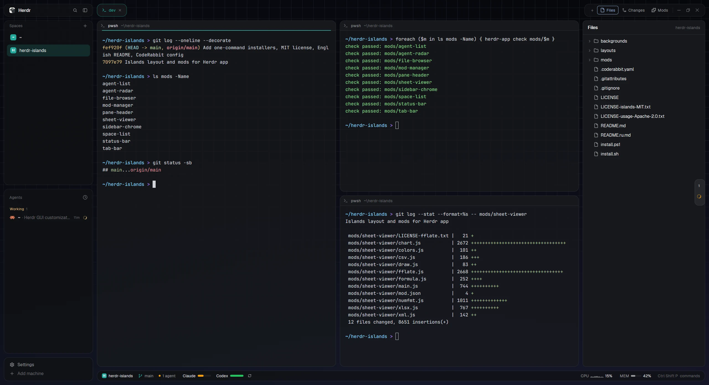
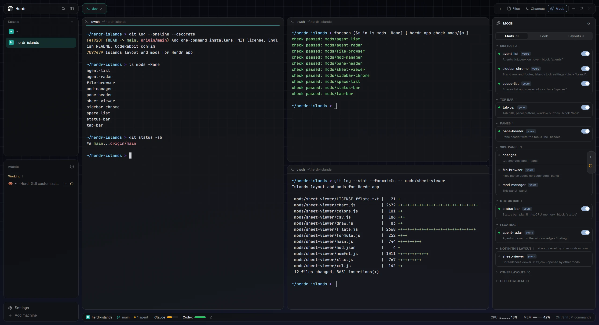
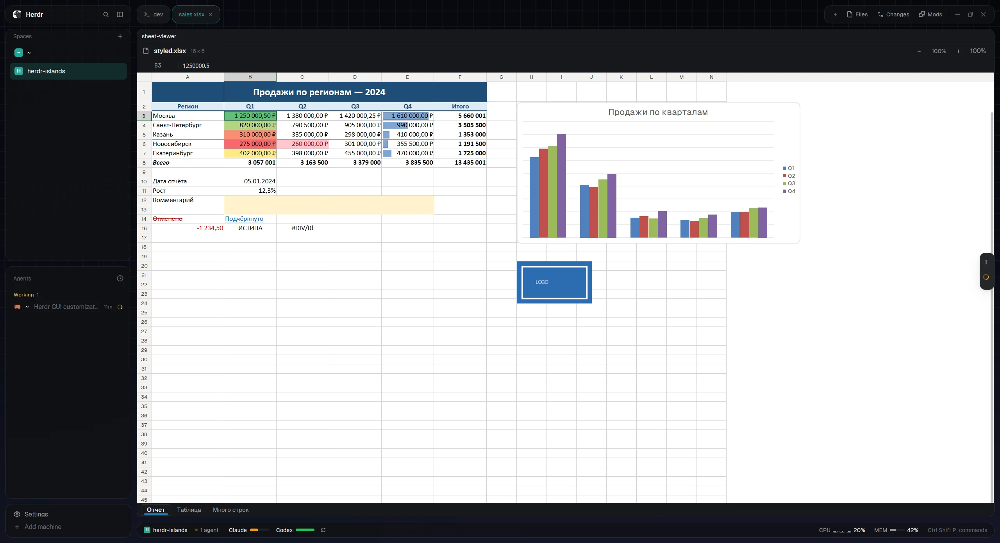

# Herdr Islands

[English](README.md) · **Русский**

Раскладка и набор модов для [Herdr app](https://herdr.dev). Каждая панель — отдельная скруглённая
карточка над сеткой, которая уходит в градиент. Ещё здесь статус-бар с лимитами AI-планов, меню Mods,
подсмотр агентов и просмотр таблиц. Написано под Windows и macOS. Вживую проверено на Windows 11;
код под Mac (`iostat`, `vm_stat`, Связка ключей, `unzip`) на настоящем Mac ещё не запускался.



## Установка

Одна команда. Herdr можно не закрывать. Повторный запуск обновляет всё и не трогает твои настройки.

**Windows** (PowerShell):

```powershell
irm https://raw.githubusercontent.com/Yofukashiya/herdr-islands/main/install.ps1 | iex
```

**macOS** (Terminal):

```sh
curl -fsSL https://raw.githubusercontent.com/Yofukashiya/herdr-islands/main/install.sh | sh
```

Нужен Herdr app 0.1.13 или новее. На Mac перед командой один раз открой Herdr из «Программ»: при первом
запуске он создаёт команду `herdr-app`, которой пользуется скрипт.

Что делает скрипт:
1. скачивает этот репозиторий;
2. копирует моды, раскладку и фон в `~/.config/herdr-app`;
3. проверяет каждый мод через `herdr-app check`;
4. запускает Herdr, если он закрыт, и переключает его на раскладку Islands.

Новая папка мода появляется одним переименованием, так что открытый Herdr никогда не увидит недокопированный
мод (он вставил бы его в раскладку лишней панелью). Остальное в папке Herdr не трогается: темы, клавиши
и другие раскладки остаются как были.

<details>
<summary>Установка из клона или вручную</summary>

Из клона: `powershell -ExecutionPolicy Bypass -File install.ps1` на Windows, `sh install.sh` на Mac.

Вручную, при закрытом Herdr: скопируй `layouts`, `mods` и `backgrounds` в `~/.config/herdr-app`
(на Windows `C:\Users\<ты>\.config\herdr-app`). Потом открой Herdr и выполни
`herdr-app do layout.switch --name islands` или переключай раскладки Ctrl+Shift+L.
Копируй настоящими файлами, не симлинками: картинки по симлинкам Herdr не открывает.
</details>

На Mac при первом запросе лимитов Claude macOS спросит, можно ли программе `security` прочитать
«Claude Code-credentials» из Связки ключей: Claude Code хранит вход там. Нажми **Всегда разрешать**.
Если откажешь, Claude просто не появится в статус-баре.

### Только некоторые моды

Каждый мод работает и сам по себе, в твоей собственной раскладке. Назови нужные:

```powershell
& ([scriptblock]::Create((irm https://raw.githubusercontent.com/Yofukashiya/herdr-islands/main/install.ps1))) status-bar sheet-viewer
```

```sh
curl -fsSL https://raw.githubusercontent.com/Yofukashiya/herdr-islands/main/install.sh | sh -s -- status-bar sheet-viewer
```

Так ставятся только эти моды, без раскладки и без её переключения, и скрипт пишет, куда поставить каждый.
То же видно в таблице ниже, а подробности есть в README каждого мода.

### Обновления

Islands сам сообщает о новых релизах. Раз в сутки он спрашивает GitHub. Когда выходит новая версия:
- Herdr показывает уведомление; клик по нему открывает Mods.
- В панели Mods появляются **What's new** и **Update**.
- **Update** ставит релиз в фоне, и Herdr перезагружает моды. Настройки сохраняются, раскладка
  не переключается.

Текущая версия и кнопка **Check for updates** — вверху Mods.

Чтобы релизы ставились без вопросов, включи **Install updates automatically** в Mods → Look или впиши
`"auto_update": true` в `mods/sidebar-chrome/settings.json`. По умолчанию это выключено: так установщик
нового релиза запускается сам.

Вручную, или если ты поставил только некоторые моды (уведомлениям нужен `sidebar-chrome` или
`mod-manager`), запусти команду установки ещё раз. С `--update` она обновит только то, что у тебя есть,
и не переключит раскладку:

```powershell
& ([scriptblock]::Create((irm https://raw.githubusercontent.com/Yofukashiya/herdr-islands/main/install.ps1))) --update
```

```sh
curl -fsSL https://raw.githubusercontent.com/Yofukashiya/herdr-islands/main/install.sh | sh -s -- --update
```

### Обновление и удаление

Чтобы обновить, запусти ту же команду ещё раз. Настройки Look (`mods/sidebar-chrome/settings.json`)
сохранятся, а сам файл раскладки `islands` заменится, и блоки, выключенные в Mods, вернутся
([#4](https://github.com/Yofukashiya/herdr-islands/issues/4)).

Чтобы удалить, переключись на другую раскладку (Ctrl+Shift+L) и удали в `~/.config/herdr-app`:
- `layouts/islands.json`, `layouts/islands.svg` и `backgrounds/islands-grid.png`;
- папки в `mods`: `sidebar-chrome`, `space-list`, `agent-list`, `tab-bar`, `pane-header`, `file-browser`,
  `mod-manager`, `status-bar`, `agent-radar`, `sheet-viewer`.

## Что внутри

| Мод | Что делает | Сам по себе |
|---|---|---|
| [`sidebar-chrome`](mods/sidebar-chrome/README.md) | Верхняя и нижняя карточки сайдбара; применяет настройки внешнего вида | вместо `workspace-chrome` |
| [`space-list`](mods/space-list/README.md) | Пространства и их цвета | вместо `spaces` |
| [`agent-list`](mods/agent-list/README.md) | Агенты, подсмотр экрана агента при наведении | вместо `agents` |
| [`tab-bar`](mods/tab-bar/README.md) | Вкладки-пилюли, кнопки Files / Changes / Mods, кнопки окна | вместо `tabs` |
| [`pane-header`](mods/pane-header/README.md) | Шапка панели с линией фокуса | шапка панели |
| [`file-browser`](mods/file-browser/README.md) | Панель Files: открывает файлы во вкладках, меню по правому клику | вместо `files` |
| [`mod-manager`](mods/mod-manager/README.md) | Панель Mods | диалог: `mod.open` |
| [`status-bar`](mods/status-bar/README.md) | Лимиты планов, CPU, память | сам встаёт вниз окна |
| [`agent-radar`](mods/agent-radar/README.md) | Выдвижная панель агентов у края окна | плавающий блок |
| [`sheet-viewer`](mods/sheet-viewer/README.md) | Просмотрщик таблиц | открывается из `file-browser` или из терминала |

Ни один мод не требует другого: связи между ними — необязательные дополнения. Например, `space-list` даёт
остальным цвет пространства, а без него они берут акцент темы.

**Внешний вид.** Основа — [Islands](https://github.com/CodeyPacker/herdr-mods/tree/main/islands) от Cody Packer.
Идея фона взята у [herdr-van](https://github.com/VanKurnia/herdr-van): сетка на почти чёрном фоне уходит в
градиент. Сама картинка сгенерирована заново (`backgrounds/make_islands_grid.py`):
- **Размер и линии:** 3840×2160 с мягкими линиями, поэтому она одинаково гладкая на 1080p, 1440p, 4K и Retina.
- **Обрезка:** рисунок идёт сверху вниз, поэтому обрезка под 16:10, ультраширокий экран или половину экрана
  ничего важного не съедает.
- **Без полос:** дизеринг убирает полосы на тёмном градиенте.
- **Светлая тема:** вместо картинки рисуется градиент из цветов темы.

**Статус-бар.** Основа — [DanielFGray/herdr-config](https://github.com/DanielFGray/herdr-config).
- **Что показывает:** слева текущее пространство; затем лимиты Claude, Codex, OpenCode и Cursor; потом CPU,
  MEM и LOAD.
- **Цвета лимитов:** лимиты показаны как батарейка, по остатку. От 50% зелёный, от 11 до 49% янтарный,
  10% и меньше красный, и тогда он пульсирует.
- **Узкое окно:** бар подстраивается под ширину окна с учётом zoom. Второстепенное он прячет в таком
  порядке: подсказка палитры, LOAD, MEM, CPU, ветка.
- **CPU и память везде:** на Windows их даёт `typeperf`, на macOS — `iostat`, `vm_stat` и `sysctl`.
  LOAD есть на macOS и Linux; на Windows такого показателя нет.
- **Переживает перезапуск:** расписание запросов сохраняется, поэтому перезапуск Herdr не приводит к
  «rate limited».

**Анимации** нативные: без таймеров, и ничего не работает, пока элемент не виден:
- полоски лимитов и памяти плавно перетекают к новому значению;
- точка агентов пульсирует янтарным, пока агент работает, и красным, когда он ждёт тебя;
- в разделённой вкладке у активной панели появляется линия цвета пространства, а кнопки в шапке проявляются плавно.

**Подсмотр агента** (`agent-list`). Задержи мышь на агенте в сайдбаре. Появится карточка с низом его экрана
без поля ввода Claude Code или Codex; пока она открыта, она обновляется раз в 1,5 с. По клику переходишь к агенту.

**Выдвижная панель агентов** (`agent-radar`). Узкая полоска у правого края показывает, сколько агентов и в
каком они состоянии. Красная точка пульсирует, когда агент ждёт тебя; спиннер крутится, пока агент
работает. При наведении выезжает список: цвет пространства, имя, где агент, последняя строка экрана.
Полоску можно перетащить к другому краю.

**Цвет пространства как акцент.** Цвет текущего пространства окрашивает:
- активную вкладку и линию фокуса панели;
- выбранное пространство;
- плашку пространства и иконку ветки в статус-баре;
- выдвижную панель агентов.

Курсор терминала анимировать нельзя: его рисует сам Herdr (из Ghostty взято только ядро libghostty-vt,
без рендерера и шейдеров), и у модов к нему доступа нет.

## Меню Mods

Кнопка **Mods** рядом с Files и Changes открывает панель с тремя вкладками.



- **Mods.** Моды сгруппированы по месту в окне: Sidebar, Top bar, Panes, Side panel, Status bar, Floating.
  Дальше идут:
  - *Not in this layout* — твои моды, которые эта раскладка не показывает;
  - *Other layouts* — моды других раскладок (свёрнуто);
  - *Herdr system* — встроенные меню и диалоги (свёрнуто).

  Переключатель выключает мод в текущей раскладке. Ошибки модов видны в списке, у заголовка группы
  с ошибкой — красная точка. При наведении на строку появляются **Check** (`herdr-app check`) и **Folder**.
- **Look:**
  - Color: тема (graphite, ink, moss, свои) и акцент (цвет пространства, цвет темы или один из 8);
  - Surfaces: непрозрачность карточек и панелей, фон (сетка, градиент, без фона);
  - Extras: выдвижная панель агентов.
- **Layouts.** Все раскладки с превью, клик переключает.

## Настройки

Удобнее всего менять их в Mods → Look. Хранятся они в `mods/sidebar-chrome/settings.json` и применяются сразу:

```json
{ "opacity": 0.8, "main_opacity": 0.75, "backdrop": "backgrounds/islands-grid.png", "radar": true, "accent": "space" }
```

- `opacity`: непрозрачность боковых карточек и статус-бара (1 — без просвета сетки).
- `main_opacity`: непрозрачность панелей с терминалами.
- `backdrop`: `"grid"` или путь к картинке, `"gradient"` (нативный, из цветов темы) или `"plain"`.
- `radar`: `false` прячет выдвижную панель агентов.
- `accent`: `"space"`, `"theme"` или свой цвет `"#rrggbb"`.

Если нужны только некоторые сервисы в статус-баре, создай `~/.config/herdr-app/usage.json` с
`{ "providers": ["claude", "codex"] }`. `{ "providers": [] }` выключает лимиты, остаются CPU и MEM.

Фон под другую тему или размер:
1. Поправь цвета вверху `backgrounds/make_islands_grid.py`.
2. Запусти `python3 make_islands_grid.py my-grid.png`. Сохраняй под **новым** именем: Herdr кэширует
   картинку по пути, и файл, подменённый под старым именем, покажется только после перезапуска.
3. Укажи новое имя в `backdrop`.

## Панель Files

- **Левый клик** по файлу открывает его здесь, в Herdr, в отдельной вкладке:
  - код и текст — только для чтения, с подсветкой и номерами строк;
  - картинки — вписанными во вкладку;
  - таблицы — в просмотрщике таблиц.

  Если файл уже открыт, клик переключает на его вкладку.
- **Правый клик** по файлу, папке или пустому месту дерева — меню для всего остального:
  - **Open with default app** — программой по умолчанию;
  - **Open in VS Code / Cursor** — если установлены;
  - **Show in Explorer / Finder**;
  - **Copy path** / **Copy relative path**;
  - **Open terminal here** — терминал в этой папке.

Чтобы открывать файлы из этого меню в терминальном редакторе, впиши
`{ "terminal_editor": ["nvim"] }` в `mods/file-browser/settings.json`.

## Просмотр таблиц

Кликни по `.xlsx`, `.xlsm`, `.csv` или `.tsv` в панели Files: файл откроется в новой вкладке и будет
выглядеть как в Excel. Только чтение.



Что показывается:
- **Значения:** значения в числовых форматах Excel (даты, проценты, валюты и разделители — по языку
  системы), шрифты, заливки, рамки, выравнивание, перенос текста.
- **Структура:** объединённые ячейки, ширины столбцов и высоты строк, скрытые строки и листы,
  закреплённые области.
- **Условное форматирование:** цветовые шкалы, гистограммы, наборы значков, правила по значению и формуле.
- **Объекты:** стили умных таблиц, картинки, графики (столбцы, линии, области, круговые, кольцевые,
  точечные, лепестковые, пузырьковые, комбинированные) и фигуры с текстом.
- **Прочее:** примечания, ссылки, вкладки листов с их цветами.

Управление:
- колёсико прокручивает, Shift+колёсико — по горизонтали, Ctrl+колёсико или кнопки −/+ меняют масштаб (50–400%);
- стрелки, PageUp/PageDown и Ctrl+Home/End перемещают по ячейкам;
- значение или формула выделенной ячейки целиком видны в строке сверху.

Из терминала:

```sh
herdr-app do tab.new --name report.xlsx --mod sheet-viewer --props '{"file":"/полный/путь/report.xlsx"}'
```

Ограничения:
- **.xls** (Excel 97–2003) не читается: пересохрани в .xlsx.
- **Формулы** не пересчитываются: показывается результат, сохранённый в файле. Если его нет, простые
  формулы досчитываются, остальные показываются текстом формулы. Ссылки на целые колонки и строки
  (`A:A`, `1:1`) пока не вычисляются ([#2](https://github.com/Yofukashiya/herdr-islands/issues/2)).
- **Текст под углом** рисуется горизонтально; вертикальный «столбиком» поддерживается.
- **Встроенные стили умных таблиц** воспроизведены приближённо.
- **В графиках нет** линий тренда, планок погрешностей и настоящего 3D.
- **Не рисуются:** спарклайны, срезы, элементы управления формы и SmartArt.
- **Очень большие листы** (сотни тысяч ячеек) открываются медленно и могут упереться в предел памяти
  среды модов; тогда вместо листа просмотрщик напишет «out of memory»
  ([#3](https://github.com/Yofukashiya/herdr-islands/issues/3)).

**Как он читает файлы.**
- **Почему так:** Herdr выполняет скрипты модов интерпретатором, примерно в 50 раз медленнее Node, и молча
  останавливает скрипт, который работает ~0,5 с без паузы.
- **Распаковка:** книгу распаковывает сама система в `mods/sheet-viewer/.cache`. На Windows это .NET через
  `powershell`, на macOS и Linux — `unzip`.
- **Разбор:** части книги читаются нативно и разбираются короткими порциями; на экране видно, что сейчас
  читается.
- **Скорость:** тестовая книга (4 листа, 60 000 ячеек на одном) открывается примерно за 0,4 с.
- **Кэш:** кэш вкладки удаляется при её закрытии, всё старше 12 часов — при открытии следующего файла.

## Что статус-бар читает и отправляет

Читает сохранённые входы CLI:
- `~/.claude/.credentials.json` (на macOS — Связка ключей);
- `~/.codex/auth.json`;
- `auth.json` от opencode;
- базу Cursor через `sqlite3`.

С этими токенами раз в 10 минут спрашивает лимиты у самих сервисов: api.anthropic.com, chatgpt.com,
opencode.ai, cursor.com. Эндпоинты недокументированные и однажды могут перестать работать. Больше никуда
ничего не уходит. Для CPU и памяти запускает `typeperf` и один раз `powershell` на Windows, или `iostat`,
`vm_stat` и `sysctl` на macOS.

## Изменения

См. [CHANGELOG.md](CHANGELOG.md) (на английском).

## Лицензия

[MIT](LICENSE). Части из других проектов сохраняют свои лицензии:
- моды Islands: MIT, © Cody Packer ([LICENSE-islands-MIT.txt](LICENSE-islands-MIT.txt));
- `status-bar`, на основе DanielFGray/herdr-config: Apache-2.0
  ([LICENSE-usage-Apache-2.0.txt](LICENSE-usage-Apache-2.0.txt));
- `file-browser` и то, что Islands взял из встроенных модов Herdr: Herdr, Apache-2.0;
- fflate для распаковки: MIT ([mods/sheet-viewer/LICENSE-fflate.txt](mods/sheet-viewer/LICENSE-fflate.txt)).
