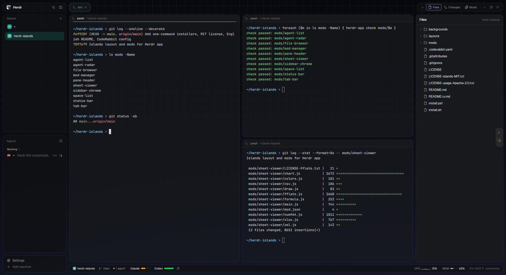

# Islands

Every part of the window is its own rounded card, floating over a dark grid that fades into a deep
indigo gradient. The sidebar, tab bar, terminal panes, side panel and a status bar are separate
islands 12px apart. The current space's color runs through all of them as the accent. Hovering an
agent peeks at its screen, a drawer of agents waits at the right edge, and spreadsheets open in an
Excel-like viewer.

This file is the brief: enough to build Islands from an empty folder. The files next to it are one
build of it (`layouts/islands.json`, eleven mods in `mods/`, the backdrop in `backgrounds/`). If they don't
work on your Herdr, or you want it different, build it again from here.

## What you see

The whole window, no title bar, 12px padding and 12px gaps everywhere. Every card has a 1px `border`
outline, a 14px radius and the theme's surface color at 80% opacity (pane cards 75%), so the grid
shows through faintly.

**Left: the sidebar**, 268px, four cards top to bottom:
1. **Brand**, 38px: Herdr's logo (20px, rounded) and "Herdr" in semibold; on the right a search
   button (opens the space and tab picker) and the sidebar toggle. Dragging it moves the window.
2. **Spaces**, half of the rest: a "Spaces" header with +, then one row per space. Each has a color
   tile with its first letter. The shown space's row is tinted with its color at 18% alpha
   (`#rrggbb2e`), and machines group their spaces under a folding header.
3. **Agents**, the other half: an "Agents" header with a sort button (Priority, or Grouped by space),
   then agents in sections: Needs you, Working, Done, Idle. A row shows the program icon, space
   and tab name, how long ago, and a status mark.
4. **Footer**, 72px: Settings and Add machine.

Folded (the toggle), the sidebar is a 44px rail (76px on macOS) of icons only.

**Right: the work column**, three bands:
1. **Tab bar**, 38px, no card behind it. Each tab is a pill; the active one has a border in the accent
   at 60% alpha and accent text, and a working tab shows a spinner. Right of the tabs, one card holds:
   - +;
   - Files, Changes and Mods (each opens the side panel on that view);
   - on Windows, minimize, maximize and close.
2. **The panes and the side panel**, side by side:
   - **Panes:** the active tab's terminals. Each is a card with a 30px header: program icon, name,
     folder, status. When the pointer is over it, split right, split down, zoom and close fade in.
   - **Side panel:** hidden until a panel button opens it, 368px. It holds Files, Changes (Herdr's own)
     or Mods. Files is a tree: a left click opens a file in a tab of its own (code with syntax colors
     and line numbers, pictures fitted, spreadsheets in the viewer), a right click opens a menu (open
     with the default app or VS Code, Explorer/Finder, copy path, terminal here).
3. **Status bar**, 32px card:
   - **Left:** a chip with the space's letter tile and name, the git branch, and an agents count with a
     dot.
   - **Middle:** plan limits for Claude, Codex, OpenCode and Cursor. Each is a 40px battery meter of
     what's left: `#22c55e` green from 50%, `#f59e0b` amber from 11 to 49%, `#ef4444` red at 10% or less.
   - **Right:** CPU with an 11px sparkline, MEM with a meter, LOAD (not on Windows) and "Ctrl Shift P
     commands".

**Over everything: the agent radar**, floating on the right edge, centered. Collapsed, it is a 30px
strip: a count, then one mark per agent. Hovered, it slides out to 300px: rows 40px high with the
space color bar, program icon, name, "space · tab", the last line of the agent's screen in mono, and a
status cell. It shows at most 8 rows and is gone when no agent runs.

**The backdrop**: 3840×2160, cover-fit. It starts near black at the top (`#050609`) and runs to deep
indigo at the bottom (`#0f111d`) on a `t^1.8` curve. Over it lies a grid of 40px cells (in 2560-wide
units), its first lines on the 12px padding, with soft 3px lines at 6% white and brighter crossings. The
grid fades out from 30% to 98% of the height. Three faint glows sit under it: blue at top left, violet
at bottom right, teal low in the middle. Light noise keeps the gradient from banding. In a light
appearance the image gives way to a gradient made from the theme's own colors.

**Mods panel** (the Mods button):
- *Mods:* every mod in groups by where it sits (Sidebar, Top bar, Panes, Side panel, Status bar,
  Floating, then Not in this layout, Other layouts, Herdr system). Each has a switch, its errors, and
  on hover Check and Folder.
- *Look:* theme chips, accent (space color, theme, or 8 swatches), card and pane opacity from 60 to
  100%, backdrop (grid, gradient, plain), radar and automatic updates.
- *Layouts:* every layout with its preview.

Above the tabs, a card offers a new release when there is one.

**Spreadsheets**: a white sheet with Excel's gridlines (`#d4d4d4`), headers (`#f3f2f1`) and selection
green (`#217346`). It shows the file's fonts, fills, borders, merges, number formats, conditional
formatting, tables, charts, pictures and comments, with sheet tabs at the bottom.

## How it behaves

| Agent status | Sidebar row | Tab | Status bar dot | Radar |
| --- | --- | --- | --- | --- |
| working | in Working, spinner | spinner in the pill | amber, slow pulse (1.8 s) | spinner |
| blocked | in Needs you, first | | red, fast pulse (0.9 s) | red dot, pulsing |
| done | in Done | | | check |
| idle | in Idle | | | dim |

- **Peek:** resting on an agent row for 450 ms opens a 560px card beside it. It shows the last 16 lines of
  the agent's screen, without the input box at the bottom of Claude Code or Codex. It refreshes every
  1.5 s and closes 220 ms after the pointer leaves both. Clicking the row or the card goes to the agent.
- **Radar:** hovering slides it out; clicking a row focuses that agent. It reads screens every 2 s, and
  only while it's out. Dragging it to another edge works (top and bottom show chips instead of rows).
- **Accent:** the shown space's color tints the active tab, the focus line under the focused pane's
  header, the space chip and branch icon in the status bar, the radar's color bars and the peek
  card. Settings can switch it to the theme's accent or a fixed color.
- **Motion** (all native, no timers):
  - limit and memory meters slide to new values (700 ms) and CPU bars grow (450 ms);
  - a limit at 10% or less pulses;
  - in a split tab, the focused pane's 2px accent line fades in (240 ms), and header buttons fade
    (160 ms);
  - "Needs you" in a header pulses.
- **Limits** refresh every 10 minutes; clicking one opens a 340px popup with each window, its reset
  time and pace.
- **Narrow windows:** the status bar drops, in order, the palette hint, LOAD, MEM, CPU and the branch;
  the sidebar can fold to its rail.
- **Updates:** once a day the brand card asks GitHub for a newer release. It then posts one notice
  per version (clicking it opens Mods) or, with automatic updates on, installs it. Mods shows the
  version and has "Check for updates".

## Built from

- **The layout** (`layouts/islands.json`):
  - **Root:** a `row` with `titlebar: "none"`, `traffic_lights: [12, 16]`, `padding: 12`, `gap: 12`,
    `terminal_padding: [16, 14]`, `terminal_opacity: 0`, a `background` image
    (`backgrounds/islands-grid.png`, `fit: "cover"`) and a `preview` (`layouts/islands.svg`). No theme:
    it follows the person's.
  - **`sidebar`:** a column of 268px (`min` 44, `max` 480, `gap` 12, not resizable) with blocks
    `brand` (38px, `window_drag`), a column of `spaces` and `agents` (weight 1 each, `min` 90) and
    `sidebar-footer` (72px). Each block has `border: {width: 1, color: "border"}` and `radius: 14`.
  - **`work`:** a column (`gap` 12) with:
    - `tabs` (38px, `window_drag`);
    - a row of `main` (`tab: "active"`) and `panel` (368px, `hidden`);
    - `status` (32px).
  - **`main`'s panes:** `header: {content: {mod: "pane-header"}, reveal: "always", height: 30,
    position: "top"}`, `background: "background"`, border 1px, `radius: 14`, `gap: 12`, `lone: true`.
  - **`panel`:** a `stack` `panel-body` of `files`, `changes` and `mods` (`file-browser`, `git-changes`
    and `mod-manager`). The tab bar's buttons open these blocks by id.
  - **Floating:** `{id: "radar", content: {mod: "agent-radar"}, edge: "right", align: "center", peek: 30}`.
- **Eleven mods**, each standalone (own icons; links between them are optional):
  - `sidebar-chrome`: brand card, and with `props: {footer: true}` the footer card.
    - The brand copy reads `mods/sidebar-chrome/settings.json` (`opacity`, `main_opacity`, `backdrop`,
      `radar`, `accent`, `auto_update`) through `watchFolder`, and shares them as `islands.*` keys.
    - It writes the root background and the panes' background with `layout.set`, but only into a
      layout whose `brand` is this mod.
    - It checks for updates.
  - `space-list` (`spaces`): a clone of the shipped `spaces`. It shares `islands.accent` and
    `islands.spaceColors` (from `space.colors`, theme ANSI hues as hex).
  - `agent-list` (`agents`): a clone of `agents`, plus `peek.js`. The peek is a `Popup` anchored to the
    row, reading the screen with `hc(["read", address])`.
  - `tab-bar` (`tabs`): a clone of `tabs` with pills. The Mods button shows when the layout has an id
    `mods`; it toggles `panel` and selects `panel-body`.
  - `pane-header`: pane headers, with `.transition("opacity")` for buttons and the focus line, and
    `.loop` for "Needs you".
  - `file-browser` (`files`): a clone of `files`, one mod in three roles by `props()`. Note that props
    come through `props()`, not `init`'s argument.
    - **None:** the panel.
    - **`{file, on}`:** a viewer tab, opened with `tab.new {mod: "file-browser"}`. It shows an
      `EditorState` (readonly, `line_numbers`) for text, or `image()` of a copy in its `.cache`, sized
      from the picture's header.
    - **`{menu}`:** the right-click popup, `openOverlay({kind: "popup"})`. It uses `cx.open_url` for
      `file://` and `vscode://file/…` and `cx.write_to_clipboard`.

    Spreadsheets go to `tab.new {mod: "sheet-viewer"}` when that mod is installed.
  - `git-changes` (`changes`): a clone of `changes`. Like `file-browser`, it follows the focused pane's
    folder, and a pane without one (a mod's tab) keeps the folder already shown. Herdr's own `files` and
    `changes` fall back to the space's folder there, spelled `D:/repo` against the terminal's `D:\repo`,
    and reset.
  - `mod-manager` (`mods`): the Mods panel; on its own it opens as a dialog with `mod.open`.
  - `status-bar` (`status`), from DanielFGray/herdr-config's `usage`:
    - **Limits:** reads CLI logins (`~/.claude/.credentials.json` or the macOS Keychain via `security`,
      `~/.codex/auth.json`, opencode's `auth.json`, Cursor's database via `sqlite3`) and calls each
      service's usage endpoint with `fetch`.
    - **System:** `typeperf` and PowerShell on Windows, `iostat`, `vm_stat` and `sysctl` on macOS,
      `/proc` on Linux.
  - `agent-radar` (floating): reads `placement()` and mirrors rows on the right edge.
  - `sheet-viewer` (opened with `tab.new`):
    - **Opening:** unzips with the system (`powershell` .NET `ZipFile` on Windows, `unzip` elsewhere)
      into its `.cache`, with vendored fflate as a fallback.
    - **Parsing:** reads parts with `fs.readFile` and parses in slices that yield with
      `cx.timer.after(1)`.
    - **Drawing:** charts with `paint_path`.
- **Data and commands:** `spaces()`, `agents()`, `panes()`, `focused()`, `layout()`, `layouts()`,
  `shared`/`setShared`, `run("agent.focus" | "pane.focus" | "pane.split" | "pane.zoom" | "pane.close" |
  "tab.new" | "tab.close" | "layout.show" | "layout.hide" | "layout.select" | "layout.set" |
  "layout.resize" | "layout.switch" | "app.theme" | "app.settings" | "mod.open")`, `notify`, `exec`, `fetch`.
- **Art:**
  - **Backdrop:** generated by `backgrounds/make_islands_grid.py` (pure Python, no libraries).
  - **Icons:** Lucide-style SVGs, tinted, in each mod's folder.
  - **Logo:** Herdr's own (`frame/welcome/herdr.png`).

## Watch out

- **Script time:** Herdr runs mods in an interpreter about 50× slower than V8 and silently kills a
  script that runs ~0.5 s without yielding. Only `cx.timer.after` yields; `await Promise.resolve()`
  does not. Anything that walks file data (the spreadsheet viewer) must slice its work.
- **Missing APIs:** there's no `TextDecoder`, `DecompressionStream` or `Buffer`. `readTextFile` stops at
  1 MiB; `fs.readFile(path, "utf8")` has no limit.
- **Colors:** `"transparent"` is rejected as a color; use `#00000000`.
- **Installing mod folders:** Herdr docks a mod folder it sees without a valid `mod.json` as a 320px
  block, and docks any new mod by its `place` the first time it sees it. Copy mod folders in whole
  (build elsewhere, then rename), and give the layout's mods `"place": "none"`.
- **Image cache:** Herdr caches images by path. A backdrop replaced under the same name shows only after
  a restart, so save a new one under a new name.
- **Opacity:** cards only look like islands if their fill is translucent. The theme's colors are faded
  in code from the settings, not set in the layout.
- **Layout guard:** the look must be written only into the Islands layout (check `brand`'s mod). The
  settings watcher otherwise restyles whatever layout is shown after a switch.
- **Background on theme change:** re-apply it after a theme or appearance change, or the panes keep the
  old theme's background.
- **Usage endpoints:** they're undocumented and rate limited. Keep the request schedule across reloads,
  or every file save asks again and Claude answers "rate limited".
- **Windows quirks:**
  - paths come with backslashes and drive letters;
  - PowerShell only waits for `herdr-app.exe` (a GUI program) when its output is piped;
  - the terminal cursor can't be animated: Herdr draws it, and mods can't reach it.
- **Assumptions:** the pane header and panel ids (`main`, `panel`, `panel-body`, `files`, `mods`) are
  what `tab-bar` and `mod-manager` look for.

## Done when

- **Look:** the window shows the five card groups over the grid, 12px apart, at 1280px wide and at 4K,
  and the status bar hides items in order as the window narrows.
- **Accent:** switching spaces recolors the active tab, the focus line, the status bar chip and the
  radar bars.
- **Statuses:** an agent that needs you jumps to the top of Agents, pulses red in the status bar and on
  the radar, and hovering it shows its screen without the input box.
- **Side panel:** Files, Changes and Mods open in the side panel; Mods lists every mod in its group,
  switches one off and back on, and changes theme, accent, opacity and backdrop live.
- **Spreadsheets:** clicking an `.xlsx` in Files opens it in a tab with its colors, merges, formats and
  charts.
- **Checks:** `herdr-app check` passes for all eleven mods, and switching to another layout and back
  leaves that other layout untouched.
